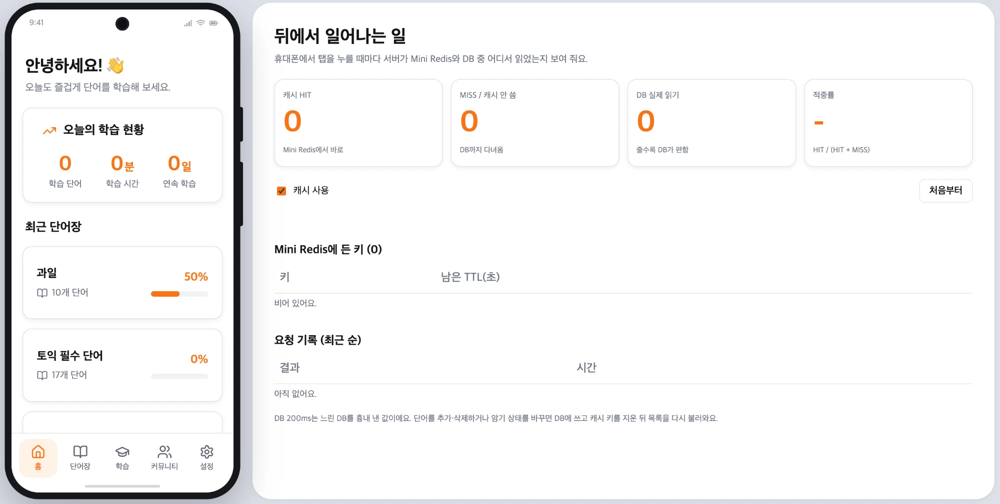

# Mini Redis

해시테이블을 직접 구현한 인메모리 키-값 저장소입니다. Python + FastAPI의 HTTP API로 열고, 느린 API 앞에 캐시(cache-aside)로 붙여 성능 차이를 측정했습니다.

## 시작하기

```bash
python3 -m venv .venv && source .venv/bin/activate
pip install -e '.[dev]'   # 앱 + pytest, httpx, psycopg(PostgreSQL 연동용)
pytest
./scripts/run.sh          # http://localhost:8000
```

> Uvicorn 워커는 **1개**로 고정합니다. 워커가 여러 개면 프로세스마다 저장소가 따로 생깁니다.

## 설계

호출 방향은 **API → Store → HashTable** 한 방향뿐입니다.

| 항목 | 결정 | 이유 |
| --- | --- | --- |
| 저장소 | 직접 구현한 해시테이블, 체이닝, FNV-1a 64비트, load factor 0.75 초과 시 2배 | 평균 O(1). 내장 `hash()`는 프로세스마다 값이 달라 쓰지 않았습니다 |
| 동시성 | `RLock` 하나로 모든 명령을 직렬 실행 | 단순하고 확실합니다. Redis의 명령 직렬 실행과 같은 효과입니다 |
| 만료 | lazy(접근 시 삭제) + 계층형 타이밍 휠 | 아무도 읽지 않는 만료 키도 제때 회수합니다 |
| 시간 | 벽시계 epoch ms, 시계는 주입 | 영속화해도 의미가 유지되고, 테스트는 가짜 시계로 sleep 없이 가능합니다 |
| 스탬피드·stale set | Lease 토큰 | `SET NX` 락은 낡은 값이 늦게 써지는 것을 못 막습니다 |
| 영속성 | 스냅샷 + AOF, 1초마다 fsync | 손실은 최대 약 1초이고, AOF가 무한히 커지지 않습니다 |
| 값 타입 | String만 (INCR은 정수로 해석) | 과제 핵심은 해시테이블·TTL·동시성입니다 |

### 동작 흐름


요청 하나가 지나는 길입니다.

1. **API**는 입력만 검증합니다(키 256B, 값 1MB, TTL). 상태는 Store를 통해서만 바꿉니다.
2. **Store**는 전역 `RLock` 하나를 잡고 명령을 하나씩 실행합니다.
   - 읽기(GET): 만료를 확인하고(lazy), 있으면 값과 남은 TTL을, 없거나 만료됐으면 404 `KEY_NOT_FOUND`를 돌려줍니다.
   - 쓰기(SET): 만료를 확인하고, **AOF 버퍼에 먼저 기록한 뒤** 해시테이블에 저장합니다. TTL이 있으면 타이밍 휠에 `(key, 만료 시각)`을 등록합니다.
3. **락 밖의 스레드**가 나머지를 맡습니다. 디스크 I/O는 락 안에서 하지 않습니다.
   - 만료 스레드는 100ms마다 휠에서 만료된 키를 최대 1,000개 꺼내 지웁니다. 꺼낸 시각이 키의 현재 만료 시각과 다르면(TTL이 바뀐 경우) 무시합니다.
   - AOF 스레드는 버퍼를 파일에 쓰고 1초마다 fsync합니다.
   - 스냅샷 스레드는 5분마다, 또는 AOF가 10MB를 넘으면 스냅샷을 뜨고 옛 AOF를 지웁니다.
4. **기동할 때** 스냅샷을 읽고 그 뒤의 AOF를 순서대로 재생합니다. 만료 시각이 지난 항목은 건너뛰고, 복구가 끝난 뒤에 만료 스레드와 서버를 시작합니다.

## 데모 시연



### 문제 정의

예전에 온라인 기반 단어장 앱을 개발하면서 캐시가 필요하다고 느꼈었습니다. 사용자가 만든 단어장을 **단어장 메뉴에 들어갈 때마다** DB에서 다시 불러와 목록은 자주 열리고 가끔만 바뀌는데, 열 때마다 같은 DB 읽기를 반복하니 화면이 느렸고 서버비 낭비가 심했습니다.

그때 겪은 문제를 그대로 재현해 데모로 만들었습니다. 왼쪽 화면은 그 단어장 앱을 그대로 본뜬 것입니다. DB도 캐시도 진짜입니다. 단어는 PostgreSQL에 저장하고, 단어장 목록을 읽을 때 복습 기록 200만 건을 집계해 단어별 복습 횟수를 계산합니다(이 컴퓨터에서 약 50ms). 그 앞에 별도 서버로 뜬 Mini Redis를 HTTP로 붙여 읽고 쓰고 지웁니다.

해결책은 DB 앞에 캐시를 두는 것입니다. DB가 창고라면 Redis는 책상 서랍입니다. 그래서 `dict` 없이 해시테이블부터 직접 만든 저장소, Mini Redis를 앞에 붙였습니다.

```
메뉴 진입 → Mini Redis에 있나?
              ├ 있다 (HIT)  → 바로 돌려준다
              └ 없다 (MISS) → DB에서 읽고, TTL 60초로 서랍에 넣고 돌려준다
단어를 추가·삭제   → DB에 쓰고, 서랍(캐시)을 비운다
```

이 패턴이 cache-aside입니다.

### 실행

```bash
docker start mini-redis-pg # 1) 진짜 PostgreSQL을 켭니다 (처음이면 아래 안내대로 컨테이너를 만듭니다)
./scripts/demo.sh          # 2) 서버 4개를 켜 둔 채 Ctrl+C까지 기다립니다
./scripts/demo.sh --once   # 터미널 데모만 보고 바로 끝냅니다
```

`demo.sh`는 PostgreSQL이 `PG_DSN`(기본 `127.0.0.1:5433`)에 떠 있으면 단어장 화면에 그것을 쓰고, 없으면 200ms 지연을 흉내 낸 메모리 DB로 대신합니다. 발표 전에는 `curl -s http://127.0.0.1:8003/api/state`의 `db`가 `postgres`인지 확인하세요. 화면에서는 단어 카드에 "복습 N회"가 보이면 진짜 DB입니다.

처음 한 번은 컨테이너를 만들어야 합니다. 이 명령과 측정용 데이터 준비는 [bench/README.md](bench/README.md)에 있습니다. 복습 기록 200만 건은 단어장 서버가 처음 켜질 때 자동으로 만들어서 몇 초 걸립니다.

```bash
docker run -d --name mini-redis-pg -e POSTGRES_PASSWORD=bench -e POSTGRES_DB=bench -p 127.0.0.1:5433:5432 postgres:16
```

서버 포트가 이미 쓰이고 있다는 오류(`address already in use`)가 나면 `demo.sh`가 이미 떠 있는 것입니다. 그대로 브라우저를 열면 됩니다.

`--once`는 같은 요청을 반복해 속도 차이를 터미널에 출력합니다. 이 터미널 데모만 200ms 지연을 넣은 가짜 원본 API를 씁니다.

```
1번째: MISS     208 ms     ← 캐시에 없어서 느린 원본까지 감
2번째: HIT        2 ms     ← Mini Redis에서 바로 돌려줌
샘플 앱  {"hits":3,"misses":2}
원본 API {"calls":2}       ← 요청 5번 중 원본은 2번만 불림
```

포트는 `REDIS_PORT`(8000), `ORIGIN_PORT`(8001), `SAMPLE_PORT`(8002), `DEMO_PORT`(8003) 환경 변수로 바꿉니다. 서버를 따로 띄우는 방법은 [sample_app/README.md](sample_app/README.md)에 있습니다.

서버를 켜 둔 상태에서 브라우저로 **http://127.0.0.1:8003/** 을 열면 단어장 앱이 뜹니다. 왼쪽은 앱 화면, 오른쪽은 HIT/MISS 집계, DB 읽기 횟수, Redis 키와 남은 TTL입니다. 단어장 탭에 들어갈 때마다 목록을 불러오고, 단어를 추가·삭제하거나 암기 상태를 바꾸면 캐시를 비웁니다.

## 성능 측정

시연과 서버 측정 모두 지연을 만들지 않고 **진짜 PostgreSQL**을 씁니다. 쿼리가 실제로 걸린 시간이 그대로 응답 시간입니다.

앱이 두 개 있고 목적이 다릅니다.

| | 단어장 앱 (시연) | 측정용 앱 (서버 측정) |
| --- | --- | --- |
| 파일 | `sample_app/vocab_app.py` | `sample_app/pg_app.py` |
| 생김새 | 브라우저 화면, 단어 추가·삭제 | 화면 없음, `GET /items/{id}` 하나뿐 |
| 목적 | 사람이 눈으로 **캐시가 어떻게 동작하는지** 봅니다 | 스크립트가 요청 2,000개를 보내 **캐시 켬/끔의 응답 시간 차이**를 잽니다 |

둘 다 같은 구조(cache-aside)로 같은 PostgreSQL 앞에 Mini Redis를 둡니다. 서버 측정은 단어장 앱을 잰 것이 아니라, 일정한 요청을 반복해서 보내기 쉽도록 따로 만든 측정용 앱을 잰 것입니다. 시연에서 본 느낌을 여러 번 반복한 숫자로 확인하는 단계입니다.

측정은 macOS(Apple Silicon, 논리 코어 10개), Python 3.13.14, PostgreSQL 16(Docker 컨테이너, 같은 컴퓨터)에서 돌렸습니다. 다른 컴퓨터에서는 절대값이 달라지고 방향만 같습니다.

### 데모 시연과 서버 측정 비교

| | 데모 시연 (단어장 앱) | 서버 측정 (측정용 앱, `bench/db_cache_effect.py`) |
| --- | --- | --- |
| 하는 일 | 사람이 단어장 탭을 눌러 MISS와 HIT를 눈으로 봅니다 | 서버를 띄워 요청 2,000개를 자동으로 보내고 응답 시간을 잽니다 |
| 요청 방식 | 한 번에 하나 | 동시 요청 16개 |
| DB | 진짜 PostgreSQL (복습 기록 200만 건 집계) | 진짜 PostgreSQL (주문 200만 건 집계, 가벼운 쿼리도 함께) |
| 캐시 끔 | 약 50ms (`BYPASS`) | 무거운 쿼리 p50 146.6 ~ 152.0ms |
| MISS (DB까지) | 약 70ms | 첫 요청 p50 127.0 ~ 135.3ms |
| HIT (캐시에서) | 약 1ms | p50 11.6 ~ 12.8ms |
| 용도 | 캐시가 어떻게 동작하는지 이해 | 실제 DB 앞에서 캐시 효과의 크기를 숫자로 확인 |

- 데모는 한 번에 하나, 측정은 동시 요청 16개라 같은 쿼리도 측정 쪽이 더 느리게 나옵니다(캐시 끔 약 50ms 대 약 150ms, HIT 약 1ms 대 약 12ms). 동시 요청이 CPU를 나눠 쓰기 때문으로 짐작하지만 원인까지 따로 재지는 않았습니다.
- 데모의 시간은 직접 눌러 본 값이고 정밀하게 재지 않았습니다. 효과의 크기는 아래 서버 측정 값을 기준으로 합니다.

### 서버에서 잰 결과

숫자는 `python -m bench.db_cache_effect`가 서버를 직접 띄워 진짜 HTTP로 잰 값입니다. 준비와 재현 방법은 [bench/README.md](bench/README.md)에 있습니다.


**비교 대상**: 측정용 앱(`pg_app.py`)에 요청을 보냈을 때, 캐시를 끈 경우(매 요청이 PostgreSQL까지)와 켠 경우(Mini Redis에 있으면 DB에 가지 않음)의 응답 시간입니다. 앱 코드는 같고 캐시 사용 여부만 다릅니다. 쿼리 무게를 둘로 나눠 쟀습니다.

- **가벼운 쿼리**: 기본키로 사용자 한 명 읽기
- **무거운 쿼리**: 주문 200만 건(`user_id` 인덱스 없음)에서 사용자 한 명의 카테고리별 합계

**결과: 이후 요청 2,000개 (3회 반복의 범위)**

| | 쿼리 | 캐시 끔 | 캐시 켬 |
| --- | --- | ---: | ---: |
| p50 | 무거운 | 146.6 ~ 152.0ms | 11.6 ~ 12.8ms |
| p95 | 무거운 | 290.2 ~ 305.3ms | 15.7 ~ 24.6ms |
| 처리량 | 무거운 | 92.4 ~ 93.8 req/s | 769.1 ~ 830.7 req/s |
| p50 | 가벼운 | 3.4 ~ 3.5ms | 11.3 ~ 11.5ms |
| p95 | 가벼운 | 5.5 ~ 5.7ms | 15.2 ~ 16.6ms |
| 처리량 | 가벼운 | 1,354.8 ~ 1,417.7 req/s | 779.3 ~ 793.9 req/s |
| DB 호출 | 둘 다 | 2,000 | 0 |

- **무거운 쿼리는 캐시가 크게 이깁니다.** p50이 약 11~13배 빨라지고 처리량은 약 8~9배, DB 호출은 2,000번에서 0번이 됩니다.
- **가벼운 쿼리는 캐시가 오히려 느립니다.** 기본키 한 건은 DB가 3.4ms에 끝내는데, 캐시를 켜면 Mini Redis까지 HTTP로 한 번 더 왕복해야 해서 p50이 약 11ms가 됩니다. 이 왕복이 원인이라고 짐작하지만 따로 재지는 않았습니다.
- 그래서 캐시는 **DB 쿼리가 무겁고 같은 결과를 자주 읽을 때** 이득입니다. 쿼리가 이미 빠르면 쓰지 않는 편이 낫습니다.
- 처리량은 동시 요청 16개로 고정한 값이라 Mini Redis의 처리 한계를 잰 것이 아닙니다.

**어떻게 쟀나**

- 측정용 앱(`pg_app.py`)을 `SAMPLE_USE_CACHE=0`(캐시 끔)과 `1`(캐시 켬)으로 번갈아 띄우고 `GET /items/{id}`의 응답 시간을 잽니다.
- 모드마다 프로세스 두 개(Mini Redis, 측정용 앱)를 새로 띄웁니다. 모두 Uvicorn `--workers 1`이고, Mini Redis는 빈 채로 시작합니다. DB는 미리 떠 있는 컨테이너를 씁니다.
- 요청은 두 단계입니다. **첫 요청**은 사용자 100명을 한 번씩 요청합니다(캐시가 비어 있어 전부 DB까지 갑니다). **이후 요청**은 같은 사용자에서 2,000개를 고르게 뽑습니다.
- 동시 요청 16개, 3회 반복했고 모든 회차의 값을 그대로 적었습니다. 요청마다 `perf_counter_ns`로 응답 시간을 쟀습니다.

**첫 요청 100개는 캐시가 이득이 없습니다.** 둘 다 DB까지 가고, 캐시를 켠 쪽은 Mini Redis 조회와 저장이 더 붙습니다. 가벼운 쿼리 p50은 끔 3.4 ~ 3.6ms, 켬 19.6 ~ 22.7ms였고 무거운 쿼리는 끔 106.5 ~ 130.9ms, 켬 127.0 ~ 135.3ms였습니다. 이득은 같은 키를 다시 읽을 때 나옵니다.

**한계**

- 같은 컴퓨터에서 프로세스 여러 개와 PostgreSQL 컨테이너, 측정 스크립트가 CPU를 나눠 쓰므로 다른 작업이 있으면 흔들립니다.
- 사용자를 고르게 뽑았습니다. 실제 트래픽은 몇몇 키에 몰리는 경우가 많아 hit ratio가 달라질 수 있습니다.
- DB와 앱이 같은 컴퓨터라 네트워크 지연이 거의 없습니다. DB가 원격에 있으면 캐시의 이득은 더 커집니다.
- 쿼리 두 종류만 쟀습니다. 어느 정도 무거운 쿼리부터 이득인지의 경계는 재지 않았습니다.

전체 표는 [db_cache_effect.md](bench/results/db_cache_effect.md)에 있습니다. 지연을 흉내 낸 가짜 원본(200ms)으로 먼저 잰 결과는 [cache_effect.md](bench/results/cache_effect.md)에 남아 있습니다.
