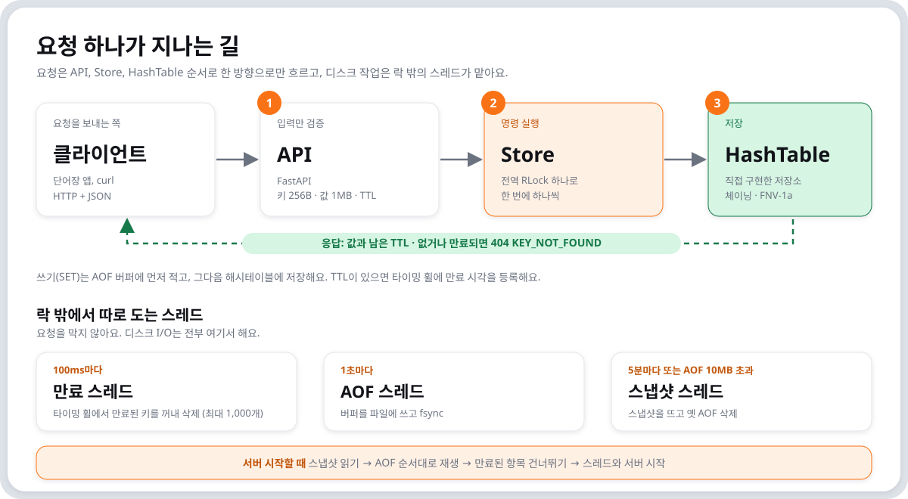
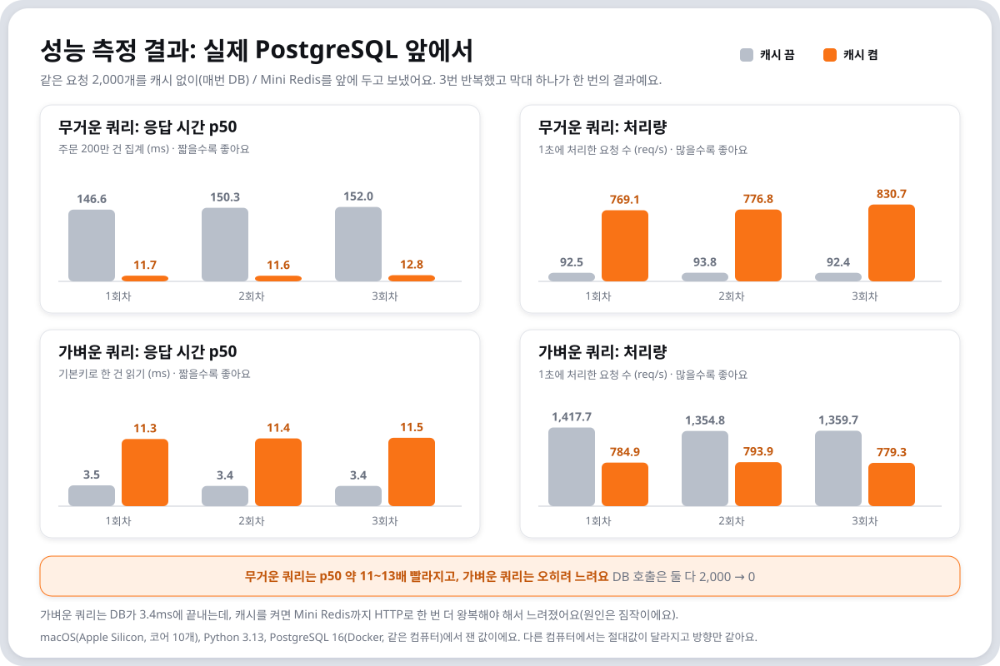

# Mini Redis

해시테이블을 직접 구현한 인메모리 키-값 저장소입니다. Python + FastAPI의 HTTP API로 열고, 느린 API 앞에 캐시(cache-aside)로 붙여 성능 차이를 측정했습니다.

## 시작하기

```bash
python3 -m venv .venv && source .venv/bin/activate
pip install -e '.[dev]'   # 앱 + pytest, httpx, psycopg(PostgreSQL 연동용)
pytest
./scripts/run.sh          # http://localhost:8000
```

> Uvicorn 워커는 **1개**로 고정합니다. 워커가 여러 개면 프로세스마다 저장소가 따로 생깁니다.

## 설계

호출 방향은 **API → Store → HashTable** 한 방향뿐입니다.

| 항목 | 결정 | 이유 |
| --- | --- | --- |
| 저장소 | 직접 구현한 해시테이블, 체이닝, FNV-1a 64비트, load factor 0.75 초과 시 2배 | 평균 O(1). 내장 `hash()`는 프로세스마다 값이 달라 쓰지 않았습니다 |
| 동시성 | `RLock` 하나로 모든 명령을 직렬 실행 | 단순하고 확실합니다. Redis의 명령 직렬 실행과 같은 효과입니다 |
| 만료 | lazy(접근 시 삭제) + 계층형 타이밍 휠 | 아무도 읽지 않는 만료 키도 제때 회수합니다 |
| 시간 | 벽시계 epoch ms, 시계는 주입 | 영속화해도 의미가 유지되고, 테스트는 가짜 시계로 sleep 없이 가능합니다 |
| 스탬피드·stale set | Lease 토큰 | `SET NX` 락은 낡은 값이 늦게 써지는 것을 못 막습니다 |
| 영속성 | 스냅샷 + AOF, 1초마다 fsync | 손실은 최대 약 1초이고, AOF가 무한히 커지지 않습니다 |
| 값 타입 | String만 (INCR은 정수로 해석) | 과제 핵심은 해시테이블·TTL·동시성입니다 |

### 동작 흐름



요청 하나가 지나는 길입니다.

1. **API**는 입력만 검증합니다(키 256B, 값 1MB, TTL). 상태는 Store를 통해서만 바꿉니다.
2. **Store**는 전역 `RLock` 하나를 잡고 명령을 하나씩 실행합니다.
   - 읽기(GET): 만료를 확인하고(lazy), 있으면 값과 남은 TTL을, 없거나 만료됐으면 404 `KEY_NOT_FOUND`를 돌려줍니다.
   - 쓰기(SET): 만료를 확인하고, **AOF 버퍼에 먼저 기록한 뒤** 해시테이블에 저장합니다. TTL이 있으면 타이밍 휠에 `(key, 만료 시각)`을 등록합니다.
3. **락 밖의 스레드**가 나머지를 맡습니다. 디스크 I/O는 락 안에서 하지 않습니다.
   - 만료 스레드는 100ms마다 휠에서 만료된 키를 최대 1,000개 꺼내 지웁니다. 꺼낸 시각이 키의 현재 만료 시각과 다르면(TTL이 바뀐 경우) 무시합니다.
   - AOF 스레드는 버퍼를 파일에 쓰고 1초마다 fsync합니다.
   - 스냅샷 스레드는 5분마다, 또는 AOF가 10MB를 넘으면 스냅샷을 뜨고 옛 AOF를 지웁니다.
4. **기동할 때** 스냅샷을 읽고 그 뒤의 AOF를 순서대로 재생합니다. 만료 시각이 지난 항목은 건너뛰고, 복구가 끝난 뒤에 만료 스레드와 서버를 시작합니다.

## 데모 시연


### 문제 정의

예전에 온라인 기반 단어장 앱을 개발하면서 캐시가 필요하다고 느꼈었습니다. 사용자가 만든 단어장을 **단어장 메뉴에 들어갈 때마다** DB(Firebase)에서 다시 불러와 목록은 자주 열리고 가끔만 바뀌는데, 열 때마다 같은 DB 읽기를 반복하니 화면이 느렸고, Firebase는 읽은 횟수만큼 비용이 드는데 같은 데이터를 계속 읽어서 읽기 비용이 낭비됐습니다.

문제는 단어장 목록만이 아니었습니다. 화면을 열 때마다 같은 데이터를 DB에서 다시 읽는 구조라면 어느 화면에서나 같은 일이 생깁니다. 홈 화면도 그랬습니다. 홈에 들어가면 "오늘의 학습 현황"(오늘 학습 단어, 학습 시간, 연속 학습일)만 따로 늦게 로드되는 문제가 있었습니다. 홈을 열 때마다 DB(Firebase)에서 다시 불러오는데, DB가 앱 서버와 떨어진 곳에 있어서 읽을 때마다 그 거리만큼 시간이 걸렸기 때문입니다.

그래서 이 문제를 재현해 데모로 만들면서, 반복되는 읽기를 전부 Redis에 넣지 않고 **데이터의 성격에 따라 어디에 캐시를 둘지**부터 나눴습니다. 왼쪽 화면은 그 단어장 앱을 본뜬 것입니다.

- **단어장 목록**은 사용자 한 명만 읽고, 계산 없이 그대로 읽는 데이터입니다. 이런 데이터는 서버 캐시 대신 브라우 캐시를 이용해 서버 왕복을 없앴습니다. 한 번 받은 목록을 `localStorage`에 두고, 단어장 탭에 다시 들어가도 서버를 부르지 않습니다.
- **학습 통계**는 학습 기록을 집계해야 나오는 값입니다. 홈을 열 때마다 읽지만 학습할 때만 바뀌므로 **Mini Redis에 캐싱**합니다.

이렇게 나눈 근거는 아래 [성능 측정](#성능-측정)에 있습니다. 쿼리가 가벼우면 Redis를 거치는 쪽이 오히려 느렸고, 무거울 때만 크게 이겼습니다.

학습 기록은 PostgreSQL에 저장하고, DB 앞에 별도 서버로 뜬 Mini Redis를 HTTP로 붙여 읽고 쓰고 지웁니다.


이 컴퓨터에서는 PostgreSQL이 같은 컴퓨터에 있어서 DB까지의 거리가 없습니다. 그래서 시연에서는 **DB를 읽고 쓸 때마다 왕복 30ms를 대기로 더해** 그 거리를 흉내 냈습니다. 실제로 잰 값이 아니라 가정한 값이고, Redis는 앱 서버 가까이에 둔다는 전제라서 Redis 호출에는 더하지 않았습니다. 자세한 내용과 이유는 [시연의 DB 왕복 30ms 가정](#시연의-db-왕복-30ms-가정)에 있습니다.

```
홈 진입 → Mini Redis에 학습 통계가 있나?
            ├ 있다 (HIT)  → 바로 돌려준다
            └ 없다 (MISS) → DB에서 학습 기록을 집계하고, TTL 60초로 서랍에 넣고 돌려준다
학습 기록 저장  → DB에 쓰고, 통계 서랍을 비운다
단어장 탭 진입 → 브라우저에 저장해 둔 목록을 쓴다 (서버를 부르지 않는다)
```

### 실행

```bash
docker start mini-redis-pg # 1) 진짜 PostgreSQL을 켭니다 (처음이면 아래 안내대로 컨테이너를 만듭니다)
./scripts/demo.sh          # 2) 서버 4개를 켜 둔 채 Ctrl+C까지 기다립니다
./scripts/demo.sh --once   # 터미널 데모만 보고 바로 끝냅니다
```

`demo.sh`는 PostgreSQL이 `PG_DSN`(기본 `127.0.0.1:5433`)에 떠 있으면 단어장 화면에 그것을 쓰고, 없으면 통계를 읽을 때 200ms를 기다리는 메모리 DB로 대신합니다. 발표 전에는 `curl -s http://127.0.0.1:8003/api/state`의 `db`가 `postgres`인지 확인하세요.

PostgreSQL을 쓸 때는 **DB를 읽고 쓸 때마다 왕복 30ms를 대기로 더합니다.** Redis는 앱 서버 가까이에, DB는 그보다 멀리 있는 배포(예전 앱처럼 Vercel + Firebase)를 가정한 값이고, 흉내 낸 값이라는 점이 화면 아래에도 적혀 있습니다. 지연 없이 보려면 `DB_RTT_MS=0 ./scripts/demo.sh`로 켭니다.

처음 한 번은 컨테이너를 만들어야 합니다. 이 명령과 서버 측정용 데이터 준비는 [bench/README.md](bench/README.md)에 있습니다. 단어장 화면의 학습 기록 테이블은 단어장 서버가 처음 켜질 때 자동으로 만듭니다.

```bash
docker run -d --name mini-redis-pg -e POSTGRES_PASSWORD=bench -e POSTGRES_DB=bench -p 127.0.0.1:5433:5432 postgres:16
```

서버 포트가 이미 쓰이고 있다는 오류(`address already in use`)가 나면 `demo.sh`가 이미 떠 있는 것입니다. 그대로 브라우저를 열면 됩니다.

`--once`는 같은 요청을 반복해 속도 차이를 터미널에 출력합니다. 이 터미널 데모만 200ms 지연을 넣은 가짜 원본 API를 씁니다.

```
1번째: MISS     208 ms     ← 캐시에 없어서 느린 원본까지 감
2번째: HIT        2 ms     ← Mini Redis에서 바로 돌려줌
샘플 앱  {"hits":3,"misses":2}
원본 API {"calls":2}       ← 요청 5번 중 원본은 2번만 불림
```

포트는 `REDIS_PORT`(8000), `ORIGIN_PORT`(8001), `SAMPLE_PORT`(8002), `DEMO_PORT`(8003) 환경 변수로 바꿉니다. 서버를 따로 띄우는 방법은 [sample_app/README.md](sample_app/README.md)에 있습니다.

서버를 켜 둔 상태에서 브라우저로 **http://127.0.0.1:8003/** 을 열면 단어장 앱이 뜹니다. 왼쪽은 앱 화면, 오른쪽은 통계 HIT/MISS 집계, DB 읽기 횟수, Redis 키와 남은 TTL, 요청 기록입니다.

1. **홈**에 들어갈 때마다 학습 통계를 불러옵니다. 처음은 MISS, 다시 들어가면 HIT이고 키 `vocab:stats:demo`가 TTL과 함께 보입니다.
2. **학습** 탭에서 플래시카드로 단어를 학습하면 기록을 DB에 쓰고 통계 키를 지웁니다. 홈에 다시 들어가면 MISS로 다시 집계하고 숫자가 올라가 있습니다.
3. **단어장** 탭은 브라우저에 저장해 둔 목록을 씁니다(요청 기록에 회색 "브라우저"로 표시). 단어를 추가·삭제하거나 암기 상태를 바꾸면 서버에 쓰고 저장해 둔 목록도 같이 고칩니다.

## 성능 측정

서버 측정은 지연을 만들지 않고 **진짜 PostgreSQL**을 씁니다. 쿼리가 실제로 걸린 시간이 그대로 응답 시간입니다. (데모 시연의 DB 왕복 30ms 가정은 시연에만 쓰이고, 아래 서버 측정에는 들어가지 않습니다.)

서버 측정은 단어장 앱을 잰 것이 아니라, 일정한 요청을 반복해서 보내기 쉽도록 따로 만든 측정용 앱을 잰 것입니다.
측정은 macOS(Apple Silicon, 논리 코어 10개), Python 3.13.14, PostgreSQL 16(Docker 컨테이너, 같은 컴퓨터)에서 돌렸습니다. 다른 컴퓨터에서는 절대값이 달라질 수 있습니다.

### 데모 시연과 서버 측정 비교

| | 데모 시연 (단어장 앱) | 서버 측정 (측정용 앱, `bench/db_cache_effect.py`) |
| --- | --- | --- |
| 하는 일 | 사람이 홈 탭을 눌러 MISS와 HIT를 눈으로 봅니다 | 서버를 띄워 요청 2,000개를 자동으로 보내고 응답 시간을 잽니다 |
| 요청 방식 | 한 번에 하나 | 동시 요청 16개 |
| DB | PostgreSQL (학습 기록 약 80건 집계), 왕복 30ms 가정 | PostgreSQL (주문 200만 건 집계, 가벼운 쿼리도 함께), 지연 없음 |
| 캐시 끔 | 약 37ms (`BYPASS`) | 무거운 쿼리 p50 146.6 ~ 152.0ms |
| MISS (DB까지) | 약 43ms | 첫 요청 p50 127.0 ~ 135.3ms |
| HIT (캐시에서) | 약 1.4ms | p50 11.6 ~ 12.8ms |
| 용도 | 캐시가 어떻게 동작하는지 이해 | 실제 DB 앞에서 캐시 효과의 크기를 숫자로 확인 |

### 서버에서 잰 결과

숫자는 `python -m bench.db_cache_effect`가 서버를 직접 띄워 진짜 HTTP로 잰 값입니다. 준비와 재현 방법은 [bench/README.md](bench/README.md)에 있습니다.



**비교 대상**: 측정용 앱(`pg_app.py`)에 요청을 보냈을 때, 캐시를 끈 경우(매 요청이 PostgreSQL까지)와 켠 경우(Mini Redis에 있으면 DB에 가지 않음)의 응답 시간입니다. 앱 코드는 같고 캐시 사용 여부만 다릅니다. 쿼리 무게를 둘로 나눠 쟀습니다.

- **가벼운 쿼리**: 기본키로 사용자 한 명 읽기
- **무거운 쿼리**: 주문 200만 건(`user_id` 인덱스 없음)에서 사용자 한 명의 카테고리별 합계

**결과: 이후 요청 2,000개 (3회 반복의 범위)**

| | 쿼리 | 캐시 끔 | 캐시 켬 |
| --- | --- | ---: | ---: |
| p50 | 무거운 | 146.6 ~ 152.0ms | 11.6 ~ 12.8ms |
| p95 | 무거운 | 290.2 ~ 305.3ms | 15.7 ~ 24.6ms |
| 처리량 | 무거운 | 92.4 ~ 93.8 req/s | 769.1 ~ 830.7 req/s |
| p50 | 가벼운 | 3.4 ~ 3.5ms | 11.3 ~ 11.5ms |
| p95 | 가벼운 | 5.5 ~ 5.7ms | 15.2 ~ 16.6ms |
| 처리량 | 가벼운 | 1,354.8 ~ 1,417.7 req/s | 779.3 ~ 793.9 req/s |
| DB 호출 | 둘 다 | 2,000 | 0 |

- **무거운 쿼리는 캐시가 크게 이깁니다.** p50이 약 11~13배 빨라지고 처리량은 약 8~9배, DB 호출은 2,000번에서 0번이 됩니다.
- **가벼운 쿼리는 캐시가 오히려 느립니다.** 기본키 한 건은 DB가 3.4ms에 끝내는데, 캐시를 켜면 p50이 약 11ms가 됩니다.
- 그래서 캐시는 **DB 쿼리가 무겁고 같은 결과를 자주 읽을 때** 이득입니다. 쿼리가 이미 빠르면 쓰지 않는 편이 낫습니다.
- 처리량은 동시 요청 16개로 고정한 값이라 Mini Redis의 처리 한계를 잰 것이 아닙니다.

#### 왜 이런 결과가 나왔나

구조는 이미 Redis를 DB보다 **앞에** 둔 cache-aside입니다. 요청이 지나는 길은 둘 중 하나입니다.

- **HIT**: 앱 → Mini Redis에서 바로 응답 (DB에 가지 않음)
- **MISS**: 앱 → Mini Redis(없음) → DB에서 읽기 → Mini Redis에 저장 → 응답

시간이 어디서 드는지 보려고 같은 측정을 **동시 요청 1개**로도 했습니다(`--concurrency 1 --requests 1000 --repeat 3`, 전체 표는 [db_cache_effect_concurrency1.md](bench/results/db_cache_effect_concurrency1.md)). 이후 요청 p50은 다음과 같습니다(3회 반복의 범위).

| 쿼리 | 동시 요청 | 캐시 끔 (DB 직접) | 캐시 켬 (HIT) |
| --- | --- | ---: | ---: |
| 가벼운 | 1개 | 0.6ms | 0.8 ~ 0.9ms |
| 가벼운 | 16개 | 3.4 ~ 3.5ms | 11.3 ~ 11.5ms |
| 무거운 | 1개 | 21.5 ~ 22.7ms | 0.9ms |
| 무거운 | 16개 | 146.6 ~ 152.0ms | 11.6 ~ 12.8ms |

- **첫 요청이 느린 이유는 MISS 길 때문입니다.** 캐시가 비어 있어서 Mini Redis에 묻고(없음), DB에서 읽고, 다시 Mini Redis에 저장하는 일이 더 붙습니다. 동시 요청 1개일 때 가벼운 쿼리는 0.9ms에서 2.1 ~ 2.3ms로, 무거운 쿼리는 20.2 ~ 20.8ms에서 25.2 ~ 25.4ms로 늘었습니다(약 1 ~ 5ms). 이 비용은 같은 키를 처음 읽을 때 한 번만 듭니다.
- **이후 요청에서 가벼운 쿼리가 느린 이유는 순서나 MISS 때문이 아닙니다.** 이후 요청은 전부 HIT였습니다(DB 호출 0). 동시 요청이 1개일 때는 HIT 0.8 ~ 0.9ms로 DB 직접(0.6ms)과 거의 같고, 16개가 한꺼번에 들어올 때 약 11ms로 늘어납니다. DB 직접도 0.6ms에서 3.4ms로 늘지만 그보다 더 크게 늘어납니다. Mini Redis를 프로세스 하나(`--workers 1`), 전역 락 하나로 돌려서 동시 요청이 줄을 서기 때문으로 짐작하지만 따로 재지는 않았습니다.
- **무거운 쿼리는 DB가 느린 만큼 캐시가 이깁니다.** 요청이 하나씩 올 때도 21.5 ~ 22.7ms에서 0.9ms로 약 24배 빠릅니다. 동시 요청이 16개가 되면 DB 직접은 약 150ms로 약 7배 느려지고 처리량은 46 req/s 안팎에서 93 req/s 안팎으로 약 2배밖에 늘지 않습니다. 같은 DB를 여러 요청이 나눠 쓰면 DB가 병목이 되고, 캐시는 그 읽기를 대신 받아 11 ~ 13ms, 770 ~ 830 req/s를 유지합니다.

### 결론

**Redis는 반복적으로 발생하는 DB 작업을 줄여 시스템 전체의 성능을 개선하는 도구입니다.**

- 자주 조회하는 데이터의 응답 시간 단축
- DB의 반복적인 조회 부하 감소
- 대량의 동시 요청을 처리할 때 DB 병목 완화

이번 측정에서는 무거운 쿼리가 p50 약 11~13배 빨라지고 처리량이 약 8~9배 늘었으며, 요청 2,000개에서 DB 호출이 2,000번에서 0번이 됐습니다. 다만 쿼리가 이미 가벼우면(기본키 조회) 동시 요청이 몰릴 때 Mini Redis를 거치는 비용이 DB보다 커서 오히려 느렸습니다. 그래서 반복해서 읽고 DB가 무거운 데이터에 쓸 때 효과가 큽니다.
